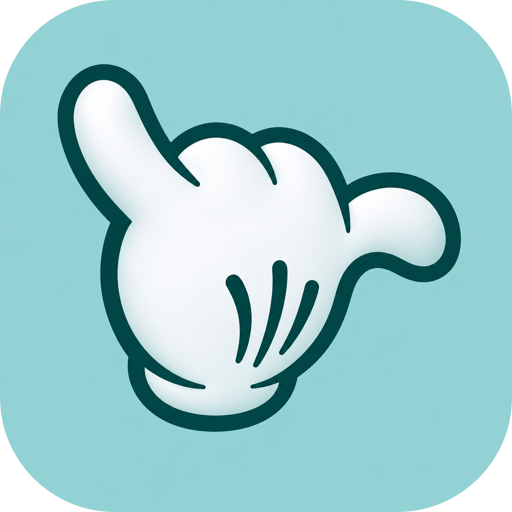

<p align="center">
  
</p>

# Helping Hand

Transform text with your saved prompts using Claude, Codex, Raycast AI, Ollama or Apple Intelligence, and search Azure DevOps work items and pull requests without leaving Raycast.

## Commands

| Command          | What it does                                                                        |
| ---------------- | ----------------------------------------------------------------------------------- |
| **Prompts**      | Pick a saved prompt and run it on your clipboard or typed text with any AI provider |
| **DevOps Board** | Search Azure DevOps work items and PRs by ID, title, link or filter tokens          |

## Requirements

You only need the providers you plan to use. Unavailable providers show their status (for example "Not installed") in the provider menu (⌘M).

| Provider               | Needs                                                                                                                   |
| ---------------------- | ----------------------------------------------------------------------------------------------------------------------- |
| **Claude**             | [Claude Code](https://docs.anthropic.com/en/docs/claude-code) CLI (`claude`) installed and logged in                    |
| **Codex**              | [Codex](https://github.com/openai/codex) CLI (`codex`) installed and logged in                                          |
| **Apple Intelligence** | macOS 26 or later on Apple Silicon with Apple Intelligence turned on. Runs on-device through a bundled helper binary    |
| **Raycast AI**         | Raycast Pro                                                                                                             |
| **Ollama**             | [Ollama](https://ollama.com) running on `http://localhost:11434` with your chosen model pulled (`ollama pull llama3.2`) |

The CLIs are looked up in `~/.local/bin`, `/opt/homebrew/bin`, `/usr/local/bin` and your `PATH`.

## Prompts

### Input

Your clipboard is captured when the command opens. Switch input with the dropdown in the search bar:

- **Clipboard** (⌘⌥1): uses the captured clipboard text. Reload it with ⌘⇧R.
- **Typed** (⌘⌥2): the search bar becomes your input box. Use **Edit Input in Larger Editor** for longer text.

### Writing prompts

Create a prompt with ⌘N. Mark where your input goes with a placeholder:

| Placeholder   | Replaced with    |
| ------------- | ---------------- |
| `{text}`      | The input        |
| `{input}`     | Same as `{text}` |
| `{clipboard}` | Same as `{text}` |

If a prompt has no placeholder, the input is added to the end of it.

```text
Rewrite {text} in a friendly, casual tone.
```

Each prompt can have an icon, a colour and a **pinned provider**. A pinned prompt always runs with that provider, whatever the dropdown says.

### Running and using output

- **↵** runs the selected prompt. Output streams into the detail pane.
- **Paste to [App]** pastes into the app you came from. Markdown is converted to rich text, so it pastes formatted into apps like Teams or Outlook and as plain markdown elsewhere.
- **⌘U** feeds the output back in as input, so you can chain prompts.
- **⌘R** regenerates, **⌘⇧E** edits the output before pasting.

### Favourites

Star a prompt with ⌘⇧F. Your first nine favourites run straight from any prompt with ⌘1 to ⌘9.

### Import and export

- **Export** (⌘⌥E) saves all prompts to `~/Downloads/helping-hand-prompts-YYYY-MM-DD.json`.
- **Import** (⌘⇧I) accepts either a Helping Hand export or a **Raycast snippets export** (each snippet's `text` becomes the prompt).
- Re-importing a Helping Hand export replaces prompts with the same `id` rather than duplicating them.

Export format:

```json
[
  {
    "id": "4f1c…",
    "name": "Casual tone",
    "prompt": "Rewrite {text} in a friendly, casual tone.",
    "icon": "Wand",
    "color": "Blue",
    "favourite": true,
    "model": "claude"
  }
]
```

`icon` and `color` are key names from Raycast's `Icon` and `Color` enums. `model` is the pinned provider id: `claude`, `codex`, `apple`, `raycast` or `ollama`.

## DevOps Board

### Setting up a connection

Open **Manage Azure DevOps Connections** (⌘⇧A from either command) and add a connection:

| Field                     | Notes                                                                                                          |
| ------------------------- | -------------------------------------------------------------------------------------------------------------- |
| **Name**                  | Anything, e.g. "Client A"                                                                                      |
| **Organisation URL**      | `https://dev.azure.com/your-org`                                                                               |
| **Default Project**       | The project to search                                                                                          |
| **Personal Access Token** | See scopes below                                                                                               |
| **Board**                 | Optional team. Scopes area paths and `sprint:current` to that board. Leave as "Whole project" to search widely |

Create the token in Azure DevOps under **User settings → Personal access tokens** with these scopes:

- **Work Items**: Read & write (search, comments)
- **Project and Team**: Read (boards and sprints)
- **Code**: Read (pull requests)

Use **Test Connection** to check it. You can add several connections, set one as default (⌘⇧D) and switch between them in DevOps Board with ⌘⇧O. Tokens are kept in Raycast's encrypted local storage.

### Finding things

| Type                              | Finds                                                  |
| --------------------------------- | ------------------------------------------------------ |
| `4821` · `#4821` · work item link | That work item                                         |
| `!123` · PR link                  | That pull request                                      |
| `!login`                          | Active PRs with "login" in the title (`!` alone = all) |
| `login`                           | Work items with "login" in the title                   |

### Filter tokens

Mix any of these with title text, e.g. `@me type:bug sprint:current login`.

| Token                                  | Meaning                                           |
| -------------------------------------- | ------------------------------------------------- |
| `@me` · `@tom`                         | Assigned to me / anyone whose name contains "tom" |
| `type:bug,story`                       | Type contains any of these                        |
| `state:active`                         | State contains this                               |
| `sprint:current` · `previous` · `next` | Board's current sprint, or the one before/after   |
| `sprint:42` · `sprint:"Sprint 42"`     | Sprint whose name contains this                   |
| `area:MyArea` · `area:all`             | Under that area / ignore the board's areas        |
| `parent:4821`                          | Children of that work item                        |
| `tag:ui,urgent`                        | Has every one of these tags                       |

Typed tokens win over the **⌘F** filter form, which wins over the **View** dropdown.

### Views

The **View** dropdown offers **All**, **Current Sprint**, **My Work**, **My Current Sprint** and **Notifications**.

**Notifications** collects:

- Work item @mentions (last 30 days)
- PR comments that mention you, or are unresolved on your PRs
- PRs waiting for your review
- Your PRs marked waiting-for-author or rejected
- Your work items changed by someone else (last 7 days)

### Comments

**⌘⇧M** opens comments on a work item or PR. Add a comment with ⌘N (preview with ⌘⇧P) or reply to a PR thread with ⌘⇧R. Comments are written in markdown.

## Preferences

| Preference           | Default    | Notes                                                    |
| -------------------- | ---------- | -------------------------------------------------------- |
| **Default Provider** | Claude     | Selected on open. Falls back to the first ready provider |
| **Claude Model**     | `sonnet`   | Alias or ID passed to `claude --model`                   |
| **Codex Model**      | (blank)    | Passed to `codex exec -m`. Blank uses Codex's default    |
| **Ollama Model**     | `llama3.2` | Pull it first with `ollama pull`                         |

## Keyboard shortcuts

### Prompts

| Key       | Action                          |
| --------- | ------------------------------- |
| ↵         | Run prompt                      |
| ⌘↵        | Copy output                     |
| ⌘R        | Regenerate                      |
| ⌘⇧E       | Edit output                     |
| ⌘U        | Use output as input             |
| ⌘M        | Change provider                 |
| ⌘1 to ⌘9  | Run favourite                   |
| ⌘⇧F       | Add to / remove from favourites |
| ⌘N        | Create prompt                   |
| ⌘E        | Edit prompt                     |
| ⌘D        | Duplicate prompt                |
| ⌃X        | Delete prompt                   |
| ⌘⌥1 · ⌘⌥2 | Clipboard / typed input         |
| ⌘⇧R       | Reload input from clipboard     |
| ⌘⇧I · ⌘⌥E | Import / export prompts         |
| ⌘⇧A       | Manage Azure DevOps connections |

### DevOps Board

| Key       | Action                                                          |
| --------- | --------------------------------------------------------------- |
| ↵         | Open in Raycast                                                 |
| ⌘↵        | Open in browser                                                 |
| ⌘⇧↵       | Copy full ticket                                                |
| ⌘⇧C       | Copy link (rich link or markdown, depending on where you paste) |
| ⌥⌘D · ⌥⌘A | Copy description / acceptance criteria                          |
| ⌥⌘B       | Copy PR source branch                                           |
| ⌘F · ⌘⇧F  | Filter form / clear form filters                                |
| ⌘⇧M       | Show comments                                                   |
| ⌘⇧O       | Switch connection                                               |
| ⌘⇧A       | Manage connections                                              |
| ⌘R        | Refresh notifications                                           |
| ⌘/        | Cheatsheet                                                      |

## Limitations

- **Codex doesn't stream.** Output appears when it finishes.
- **CLI runs time out after 3 minutes.**
- **Work item searches return the newest 50 matches.** Narrow with filter tokens if you can't see what you want.
- **PR title search (`!text`) only looks at the newest 100 active PRs.** Azure DevOps has no server-side PR title search.
- **Notifications scan your 30 most recent involved PRs** for comment threads.
- **Sprints come from the connection's Board.** With "Whole project" selected, the project's default team is used.
- **Ollama is local only.** It's always reached on `localhost:11434`.

## Development

Requires [Bun](https://bun.sh) and Xcode command line tools (for the Apple Intelligence helper).

```sh
bun install
bun run dev      # compiles swift/apple-ai.swift, then runs ray develop
bun run build    # compiles the Swift helper, then builds to dist/
bun run lint
bun run test
```

The Apple Intelligence helper is compiled to `assets/apple-ai`. If it's missing, the provider shows as "Not built".

## License

[MIT](LICENSE)
